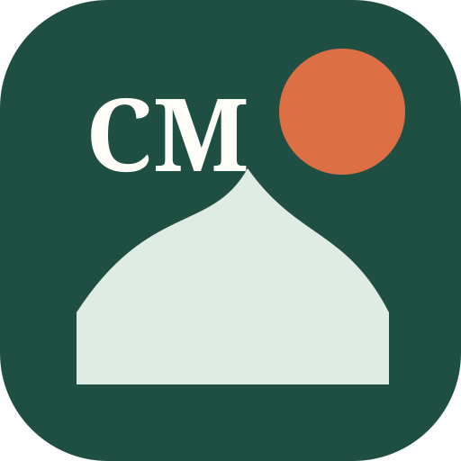

<div align="center">
  
  <h1>Manual</h1>
  <p>A private, community-maintained, mobile-first Chiang Mai life guide.</p>
  <p><a href="https://cm.caishen.today"><strong>Live demo</strong></a></p>
  <p><a href="README.md">English</a> · <a href="docs/README.zh-CN.md">简体中文</a> · <a href="docs/README.ja.md">日本語</a> · <a href="docs/README.th.md">ไทย</a></p>
</div>

## Overview

Manual turns a curated Notion workspace into a secure Progressive Web App. It combines private PIN access, fast search, category and distance filters, an interactive Thailand globe, a conventional list view, Google Maps enrichment, community submissions, and shared editing for administrators. The demo requires an account. No credentials are included in this repository.

## Features

- Chinese, English, Japanese, and Thai mobile PWA
- Named users, four-digit PIN, scrypt hashes, signed sessions, rate limits, and audit logs
- Revocable, limited-use registration codes
- Scheduled one-way Notion sync with atomic replacement and failure recovery
- Google Maps address, hours, phone, website, booking, and photo enrichment
- Globe and list views, full-text search, category filters, and 200 m to 10 km nearby ranges
- Community submissions with optional attribution and client-side photo compression
- Five stars per unique submission, with co-administrator status at 30 stars
- Administrator and co-administrator editing through a durable display override layer
- Docker deployment behind Cloudflare Tunnel without exposing the origin server

## Architecture

```text
Notion workspace
  | scheduled one-way sync
  v
data/places.json + Google Maps cache
  | merged at request time
  v
Node.js service
  + users, invitations, sessions, audit
  + community contributions and media
  + administrator display overrides
  v
Mobile PWA / Globe view / List view
  v
Cloudflare Tunnel + HTTPS
```

Notion remains the collection source. Contributions and administrator edits live under `runtime/`, so a later sync cannot erase them. Administrator edits affect the display layer and do not rewrite original Notion records.

## Quick start

Requires Node.js 22 or newer.

```bash
cp .env.example .env
npm install
npm start
```

Open `http://127.0.0.1:3000`. Generate a PIN hash with `npm run hash-pin -- 1234`, then place only the hash in `PIN_USERS_JSON`.

## Configuration

| Variable | Purpose |
|---|---|
| `SESSION_SECRET` | Session signing and invitation-code encryption |
| `PIN_USERS_JSON` | Initial accounts with hashed PINs |
| `NOTION_TOKEN` | Read access to the shared Notion source |
| `SYNC_INTERVAL_MINUTES` | One-way synchronization interval |
| `GOOGLE_MAPS_API_KEY` | Optional live Google Places fallback |
| `RUNTIME_DIR` | Persistent users, edits, media, and audit data |

Never commit PINs, API keys, tokens, private keys, tunnel credentials, or production `.env` files.

## Content sync, tests, and Docker

```bash
NOTION_TOKEN=your_token npm run sync:notion
npm test
docker compose up -d --build
curl http://127.0.0.1:3010/healthz
```

Mount `runtime/` persistently. Production must use HTTPS because production session cookies are secure-only.

## Project layout

```text
public/      PWA interface, localization, globe and list views
server.mjs  Authentication, APIs, permissions, merging, static delivery
scripts/    Notion sync, Google Maps enrichment, normalization
data/       Publishable snapshots and caches
runtime/    Private persistent state, excluded from Git
ops/        Deployment, verification, logs, manual sync
test/       Integration and taxonomy tests
```

## Security model

- Salted scrypt PIN hashes, never plain-text PIN storage
- Exponential login rate limits
- Signed, HTTP-only, same-site cookies
- Origin validation for state-changing requests
- Audit records for registration, login, permissions, codes, and content edits
- Runtime data and credentials excluded from Git

## Live example

- Primary: <https://cm.caishen.today>
- Compatibility URL: <https://cm.caishen2049.us>

Both serve the same application and data. Login credentials are intentionally not published.

## Responsible use

Before reuse, review the current terms and licenses of Notion, Google Maps, third-party photos, and imported content. Publish only media you have permission to use.
